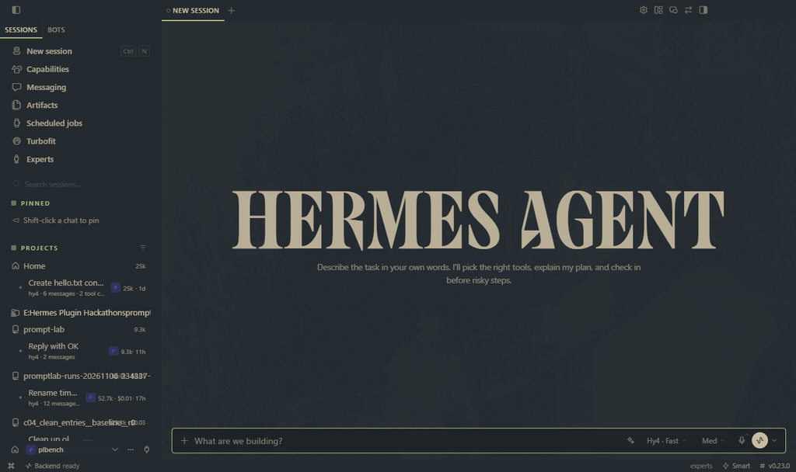
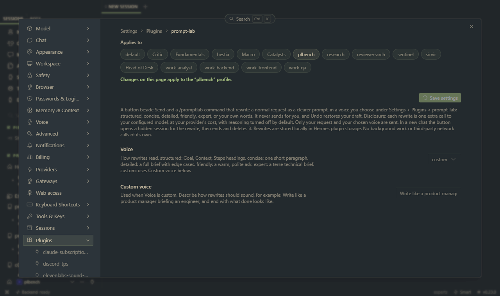

# Prompt Lab

Rewrites a normal request as a clearer prompt for an AI agent, in a voice you choose.



## Install

```bash
hermes plugins install https://github.com/tuancookiez-hub/hermes-prompt-lab
hermes plugins enable prompt-lab
```

Then turn on its Desktop part in Hermes Desktop under Capabilities > Plugins. Desktop asks before running any plugin's Desktop code.

## Use

In Hermes Desktop, type your request and press the sparkle button beside Send, or use `Ctrl+Alt+E` (`Cmd+Alt+E` on macOS). The rewrite replaces your draft so you can read and edit it before sending. Undo puts back what you typed. Press the button again while it runs to cancel. Your draft is never overwritten if you change it or switch chats during a rewrite.

In any other Hermes chat, use the command:

```text
/promptlab fix the csv export it drops the last row and dont change the api
```

## Pick a voice

Open Settings > Plugins > prompt-lab and choose a **Voice**. The command palette entry **Prompt Lab: choose voice** opens that page directly. The next rewrite uses it, with no restart. Each profile keeps its own choice.



| Voice | What you get |
|---|---|
| `structured` (default) | Goal, Context, Steps, Constraints and Done when headings |
| `concise` | One short, direct paragraph |
| `detailed` | A full brief with requirements and edge cases |
| `friendly` | A warm, polite request in plain sentences |
| `expert` | A terse technical brief |
| `custom` | Your own words from **Custom voice** |

The same request in three voices, from a real run on `tencent/hy4`:

**structured**

```text
Goal: Fix the CSV export so it does not drop the last row without changing the API.

Context:
- The CSV export currently drops the last row.
- The API must remain unchanged.

Steps:
1. Locate the CSV export logic and identify why the last row is dropped.
2. Fix the export behavior so the last row is included.
3. Verify the API remains unchanged.

Done when:
- CSV export includes the last row.
- The API is unchanged.
```

**friendly**

```text
Hi, could you please fix the CSV export so it no longer drops the last row? Please don’t change the API.
```

**custom**, with *Write like a product manager briefing an engineer, and end with one line saying what done looks like.*

```text
Fix the CSV export so it no longer drops the last row, and don’t change the API.

Done looks like: the CSV export includes the last row and the API remains unchanged.
```

Every voice keeps the language of your request, your names and details, and any `@file` references or `/commands`. It adds no features you didn't ask for. Requests under three words are left unchanged, and so is a draft already written with these headings when the voice is `structured`. The button leaves slash commands alone and never sends anything for you.

## Model

Rewrites run on the `prompt_lab` auxiliary task, which uses your main model by default. Reasoning is off by default, because long reasoning made short rewrites time out on `tencent/hy4`. Change either under `auxiliary.prompt_lab` in `config.yaml`.

## What it does on your machine

- **Model calls:** each rewrite is one extra call to your configured model, billed by your provider.
- **Data sent to that model:** only your request and the voice instructions. No files are read.
- **Hidden sessions:** in a new chat, the button opens a hidden Hermes session for the rewrite, then ends and deletes it. It is never given a prompt and stays out of your chat list. If that cleanup fails, one empty session record stays in the Hermes database, which does no harm.
- **Local storage:** each request and its rewrite are saved in Hermes plugin storage. Your voice choice is saved in `config.yaml` under `plugins.entries.prompt-lab.settings`.
- **Not used:** background work, telemetry, shell commands, and network calls of its own.

## Results so far

There is no evidence yet that these rewrites improve agent results. An earlier design was tested in a small pilot and showed no gain; see `bench/results/20261106-234337/PILOT-NOTES.md`. That benchmark is on hold and has not tested this rewriter.

## Development

Python tests, from the `tests` folder:

```bash
python -m pytest -q
```

Desktop button tests, from the repo root:

```bash
node --test tests/desktop.test.mjs
```

`bench/` is dev-only and Hermes never loads it.
